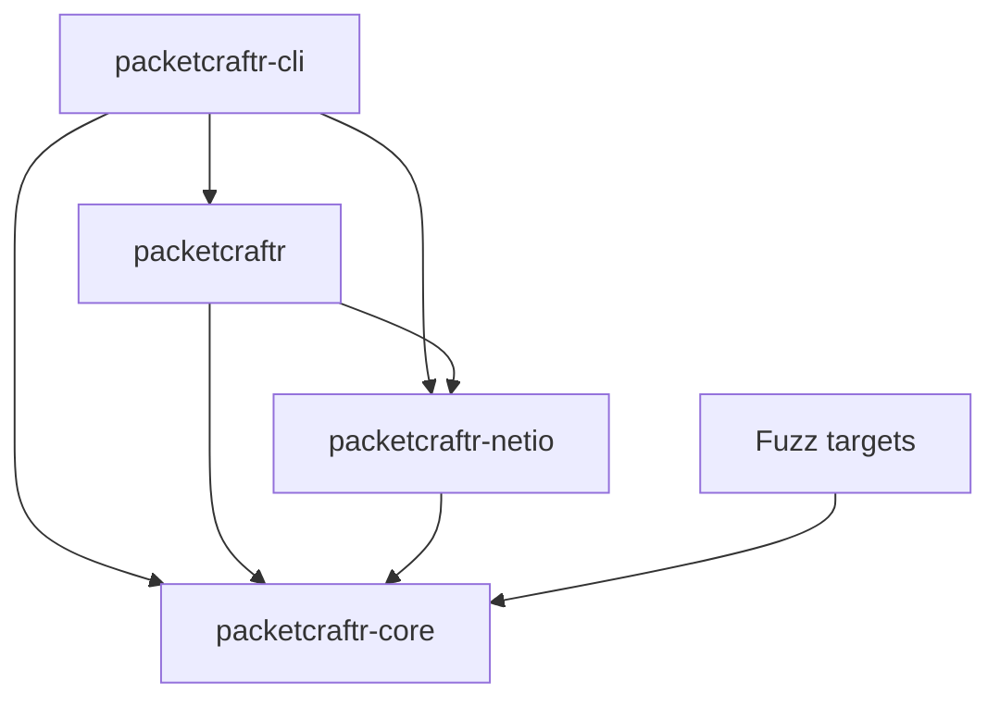

# Architecture map

PacketcraftR has three main flows: build and decode individual packets, read and analyze recorded traffic, and run policy-gated live workflows. The command line also exposes protocol and format references, generated manuals and completions, and versioned machine output.

The terminal is the interactive UI. [Terminal styling](../../crates/packetcraftr-cli/src/terminal/style.rs) owns severity and heading styles. [Assessment rendering](../../crates/packetcraftr-cli/src/commands/security/rendering.rs) produces a standalone HTML report with its own escaping and controls. Neither needs a separate web application or a database service.

## Workspace dependencies

Arrows point from the consumer to its dependency. Cargo enforces the package graph. The tables in each linked `lib.rs` define its internal layers, and [the layer checker](../../scripts/check_layers.py) checks production source references against those tables.



| Area | Responsibilities and public entry points |
| --- | --- |
| [Core](../../crates/packetcraftr-core/src/lib.rs) | Protocol definitions and the built-in registry, packet fields and codecs, expression and document parsing, packet construction and dissection, filtering and transforms, PCAP and PCAPNG, offline stream reconstruction and analysis. Runtime-neutral. |
| [Network providers](../../crates/packetcraftr-netio/src/lib.rs) | Resolver, interface and route queries, native capture and transmission, bounded socket and TLS I/O. Provider traits expose contracts. Platform modules select and implement native backends and contain the FFI. |
| [Workflows](../../crates/packetcraftr/src/lib.rs) | `Client` composes provider traits, registry, clock, and policy. Operation modules own live workflows and typed requests, events, reports, and evidence. |
| [CLI](../../crates/packetcraftr-cli/src/lib.rs) | The shared command catalog defines grouped paths, published IDs, and supported formats. The application parses global options, dispatch initiates execution, and commands adapt inputs and results to terminal and machine output. |
| [Schemas](../../schemas) and [examples](../../examples) | Versioned request and output contracts and consumable examples. Machine output uses the v23 envelope and per-command payload schemas. Historical schema IDs remain reserved. |
| [Tooling](../../scripts) and [CI](../../.github/workflows) | Document and schema validation, architecture and dependency gates, release packaging, fixtures, portable and native Rust profiles, fuzzing, and mutation and coverage checks. The CI workflow defines workspace Cargo cache paths and cleanup in shared steps. |

## State and contract owners

| State or decision | Owner and handoff |
| --- | --- |
| Protocol identity, supported fields, framing, and decode binding | Core `protocol`, `registry`, `codec`, and `layer`. Callers pass a registry into build, decode, filters, and analysis. The built-in catalog owns protocol names and dispatch. |
| CLI input sources | CLI `input::source` owns stdin recognition, platform opening, and interruptible reads. `input::bounded` applies byte and regular-file restrictions. Manifests own cumulative declaration limits. |
| Packet inputs and bounded file decoding | Core `document`, `expression`, and `capture_file`. Capture readers own source section and interface metadata and timestamp precision. Capture writers encode the selected format and own committed frame and byte totals. |
| Capture time and link types | Core [frame time](../../crates/packetcraftr-core/src/frame.rs) supplies floor seconds and nanoseconds. Core [link types](../../crates/packetcraftr-core/src/capture_file/link_type.rs) map numeric DLTs to root protocols. The CLI owns its timestamp output range and [link-type spellings](../../crates/packetcraftr-cli/src/command_options/link_type.rs). |
| Hexadecimal byte text | Core [field hex](../../crates/packetcraftr-core/src/field/hex.rs) decodes contiguous digit pairs and prints byte strings. Raw packet input accepts separators and a prefix. Expression, key log, and document readers keep their own limits and diagnostics. |
| Analysis session, flow identity, reassembly, and provenance | Core `analysis::Session` drives collectors. Core converts shared caller settings into pipeline options, and each execution path selects its stage plan. Analysis `scope`, `stream`, `reassembly`, and `provenance` retain shared state. Individual analyzers own protocol state and report evidence with source references. |
| Local evidence and findings | Core `security` owns finding, completeness, and evidence bundle types and offline collectors. The CLI selects inputs and publishes the report. |
| Native handles, capture groups, workers, and readiness | Netio provider and backend implementations own handles. `capture` owns capture groups and evidence accounting. `workers` and `resources` own native worker admission, reaping, and snapshots. |
| Live authorization and operation spending | The workflow `policy` owns target and traffic admission and scope narrowing. `client` resolves and plans with the injected providers. `engine::operation` owns cumulative per-operation spending, and `runtime` owns worker capacity. |
| Route and neighbor caches | [Route lookups](../../crates/packetcraftr/src/route/cache.rs) memoize successful provider calls for one exchange. [Neighbor state](../../crates/packetcraftr/src/neighbor/resolver.rs) owns the client's time- and capacity-bounded cache and can pin answers for one operation. The client's [interface cache](../../crates/packetcraftr/src/route/interface.rs) retains one selector and ID. |
| Time, entropy, settings, and cancellation | Core `clock` and `budget` supply injected time and deadline/cancellation values. Netio `entropy` obtains system randomness. Core option types own analysis defaults. CLI `resources` owns preset and override reporting, using the same Clap preset names as parsing. The CLI projector owns its encoded-row budget. Invocation limits supply the values displayed in help. `invocation` carries the resulting output and control state. |
| Machine and terminal output | CLI `output` owns shared envelope, stream, and contract types. Command output modules own individual payloads. `publication` and `terminal` handle output and rendering. The terminal owns regular-file text batching for the duration of the read. `staged_output` owns filesystem publication and cleanup. |
| User-visible errors and diagnostics | The failing component owns its typed error and classification. Core `diagnostic` defines diagnostic severity. CLI `errors` maps error kinds to exit status, `output::envelope` owns published representations, and `terminal::style` owns color and labels. |
| Identity and trust | Workflow `policy` approves the destination and narrows scope before live operations. Netio `tls::verification` checks peer identity and trust. Platform adapters own native handles and report unavailable capabilities. |
| Build and release policy | Workspace manifests and the lockfile own package and feature selection. The CLI and netio build scripts select capabilities from Cargo target metadata and features rather than the build host. The toolchain file pins development tools. The release asset manifest selects shipped artifacts. |

## Implementations and compatibility boundaries

| Area | Ownership and reason for separate paths |
| --- | --- |
| Capture operations | [`capture_file`](../../crates/packetcraftr-core/src/capture_file.rs) exposes byte-preserving rewrite and selection, typed mapping, normalization, and merge. Rewrite and selection preserve source records. Mapping validates identity and permitted changes. Normalization emits selected frames into a new format. Merge owns cross-input order and interface provenance. The reader and writer own format mechanics across these operations. |
| Offline analysis | [`analysis::Session`](../../crates/packetcraftr-core/src/analysis/session.rs) drives collectors, delivers observations, and finishes reports. Direct pipeline callers choose stages for their own evidence. Passive inventory can count untimed physical frames. Collector sessions derive reconstruction, stream indexing, and provenance requirements from collector needs. |
| Provider waits and workers | Netio [`deadline`](../../crates/packetcraftr-netio/src/deadline.rs) caps native waits and bridges injected time to wall time. [Native workers](../../crates/packetcraftr-netio/src/workers.rs) retain provider admission leases while they reap work. [Thread cleanup](../../crates/packetcraftr-netio/src/resources/thread_cleanup.rs) retains join ownership for application threads used by workflow [`Runtime`](../../crates/packetcraftr/src/runtime.rs). The two lifecycles account against different capacities. |
| Retries | Netio [bounded I/O](../../crates/packetcraftr-netio/src/bounded.rs) classifies transient socket errors for deadline-aware waits. Workflow attempts have their own limits and spending. Retrying a wait does not authorize another workflow attempt. |
| Observability | Terminal diagnostics consume typed events and sanitize text for display. Machine output uses its versioned envelope and payload schemas. CLI resource snapshots report configured limits and worker use. Workflow evidence records policy-gated operation outcomes. Each path has its own delivery and compatibility contract. |
| Output delivery | Text and field rows share scoped regular-file batching. JSON publishes a single aggregate with a bounded buffer. NDJSON owns per-record limits, terminal state, and worker deadlines. Staged files own atomic publication and cleanup. |
| Platform and tooling | Cargo manifests expose offline, route-only, Layer 3, and Layer 2 profiles. Native networking backends live in netio. CI checks the pinned and minimum-supported Rust versions and native and portable profiles. Workspace builds, release builds, and the fuzz workspace use caches keyed to their own artifacts. |

## Existing architecture constraints

Generate the production module graph from the same source scan that runs in CI.

```sh
python3 scripts/check_layers.py --graph > module-dependencies.dot
```

The source scan follows explicit `crate`, `self`, and `super` references across feature profiles. It does not resolve all Rust imports, expand macros, or infer method call dependencies. Nested modules are grouped under their closest documented boundary. The checker enforces dependency direction and requires every mutually reachable group to match an `Allowed cycle` entry in the crate root. Core documents its packet model as one unit. Netio documents its native provider dispatch group and the four permitted upward references as `Allowed dependency` entries. The checker rejects entries that no production reference uses. The CLI and workflow crate have no cycle groups.

The coupling checker limits clock and entropy reads, dynamic field access, casts, cancellation polls, duplicate constants and codes, and crate root exports. Cargo prevents crate cycles and the current workflow checks schema examples, CLI output, native and portable builds, and selected critical mutations.

The coupling and output-schema checks use the [same Rust source inventory](../../scripts/rust_source.py). Paths are relative to the repository. Test code and Cargo artifacts are excluded, but real modules named `target` remain in scope. The [output validator](../../scripts/check_output_schema.py) checks registered types against their defining modules and recognizes explicit stream implementations. Registry examples must match the row's command and success mode as well as the payload shape. It does not expand Rust macros or resolve arbitrary imports.

The [task pool](tasks.md) tracks completed migrations, audited contracts, and proposals that need a compatibility review.
